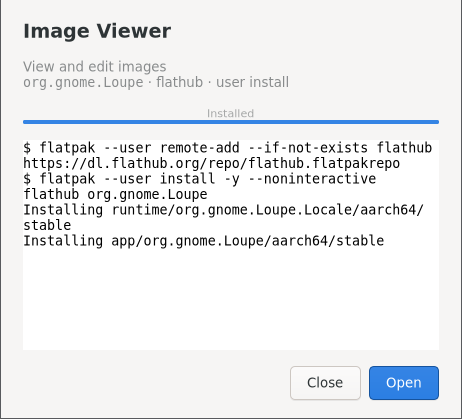
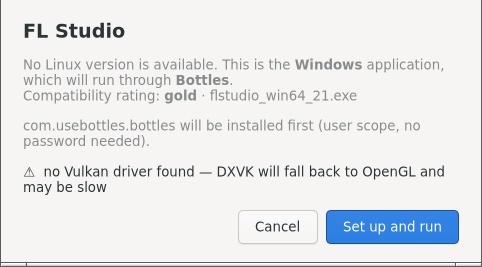
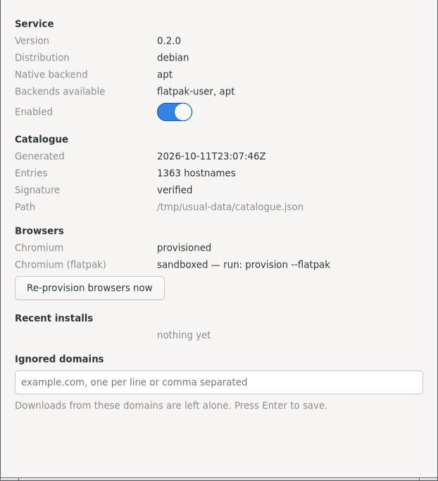

# Usual Install

*Download page in, installed app out.*



## Description

On Windows you click **Download**, run the installer, and you have the program.
On Linux the same button hands you a tarball, an AppImage with no menu entry, or
a shell command to paste into a terminal.

Usual Install puts the installer back. Download an application from the vendor's
own website and it recognises the site, finds the matching package, and installs
it with your package manager.

It is a background service. You install it once and it sets up your browsers
itself — there is no extension to find, enable, or keep up to date, and browsers
you install later are picked up on their own.

- **Any Chromium-based browser.** Chromium, Chrome, Brave, Vivaldi, Edge. Flatpak
  builds too, with one extra command.
- **No password for most installs.** Flathub applications install into your own
  user account. Only distro packages ask, and only once per session.
- **About 3,400 applications**, built from the metadata vendors already publish.
  Nothing is hand-maintained, so it does not go stale the moment someone stops
  updating a list.
- **Windows-only program?** It checks whether the app actually runs well through
  Bottles or Wine, sets it up if so, and says *not supported* if not, rather than
  leaving you with something half-broken.
- **A settings window** to turn it off, ignore particular sites, or choose which
  package source to prefer.

## It will not install the wrong thing

This is the part worth being fussy about, since the whole idea is a program that
installs software because of a web page you visited.

- Sites that host thousands of unrelated projects — GitHub, SourceForge, itch.io
  — never resolve to anything.
- A distro package is only used when the distribution's own metadata says that
  package belongs to the site you were on. `curl` installs from `curl.se` and
  from nowhere else.
- When a site genuinely offers several products, it asks. It does not guess.
- The catalogue is signed, and one that fails verification is not used at all.
- Nothing installs without you clicking **Install**.



## Installing

There is no package in any distribution yet, so you build it. You will need
`python3`, `flatpak`, `polkit`, GTK 4 with its Python bindings, and any
Chromium-based browser.

```sh
git clone https://github.com/jackofalltrades101/usual-install
cd usual-install
make all
```

`make all` downloads the application catalogue (about 11 MB), signs it with a key
it generates for your machine, and packs the browser component. It takes a minute
or two. Then build a package for your distribution:

```sh
# Debian / Ubuntu
cp -a packaging/debian debian && dpkg-buildpackage -us -uc -b
sudo apt install ../usual-install_*.deb

# Fedora
rpmbuild -ba packaging/fedora/usual-install.spec

# Arch
cp packaging/arch/PKGBUILD . && makepkg -si
```

Or install straight from the tree with `sudo make install`, though uninstalling
is then your problem.

Finally:

```sh
sudo systemctl enable --now usuald.service
```

Restart your browser and visit a download page.

### Flatpak browsers

Sandboxed browsers need one extra command, which does not need root:

```sh
usual-provision install --flatpak
```

## Configuration

`/etc/usual-install/config.json`, or the settings window (**Usual Install** in
your application menu).



| Key | Meaning |
|---|---|
| `enabled` | Turn the whole thing off without uninstalling |
| `backend_order` | `flatpak-user` first, or your distro's repositories |
| `ignored_domains` | Sites to leave alone entirely |
| `disabled_browsers` | Browsers to skip when provisioning |
| `catalogue_url` | Where to fetch catalogue updates from |

To receive catalogue updates:

```sh
sudo systemctl enable --now usual-install-update.timer
```

## Known issues

- **The browser component appears on the next launch**, not immediately. A
  browser you have installed but never run is picked up about half a minute
  after you first start it, and is ready the time after that.
- **Snap browsers are not supported and cannot be.** Snap confinement gives no
  way to reach a program outside the sandbox. Ubuntu ships Chromium as a snap, so
  on Ubuntu install a `.deb` or Flatpak browser instead.
- **No catalogue server exists yet**, so `catalogue_url` is empty and your
  catalogue is whatever `make all` built. It will go stale.
- **Compatibility coverage is thin.** WineHQ's database has no API, so the
  Windows-application support draws on a much smaller curated list and will
  usually say *not supported* even for programs that run fine.
- Chrome, Edge and Opera are expected to work but have not been tested on ARM,
  because none of them ship an ARM build for Linux.

## Not planned

- **Firefox, LibreWolf, Zen.** Different extension format, different setup
  mechanism, and Mozilla signing is mandatory. It is a second implementation
  rather than a flag, and is not started.
- **The AUR as a package source.** An AUR build script is arbitrary code, and
  running it would put the choice of what executes outside the signed catalogue.
  Arch installs come from the official repositories.
- **Silent installs.** Nothing will ever install because you visited a page. The
  window always appears and you always click Install.

## Building and hacking

`DESIGN.md` covers how resolution works and why the pieces are split the way they
are. `CONTRIBUTING.md` covers the test suite and the development environments.

## Licensing

MIT. See `LICENSE`.

Application data comes from [Flathub](https://flathub.org) and compatibility
ratings from the [Bottles](https://usebottles.com) programs list.
